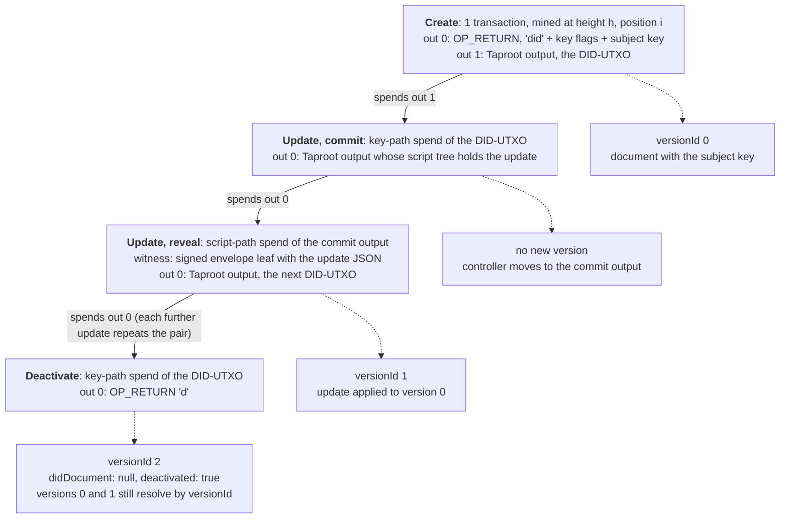

# did:btc resolver: a local create, update and deactivate demonstration

Software that writes a digital identity record into Bitcoin transactions, changes it, retires it and reads it back, on Bitcoin test networks only.

[](https://github.com/RahilBhavan/did-btc-resolver/actions/workflows/ci.yml) [](LICENSE)

An independent TypeScript implementation of the single-DID subset of MicroStrategy Orange's Bitcoin inscription DID method. It resolves chain data into DID documents, creates Taproot transactions and demonstrates key rotation and credential signature verification. The upstream specification is an **unofficial early draft**, pinned here to commit `2c45a85f90ba5f013654351a3b0224c7f523d153`, verified October 21, 2026.

**Why it matters.** A did:btc identifier is controlled by whoever holds the key for one Bitcoin output, the DID-UTXO. Every update and the deactivation must spend that output, and Bitcoin's Taproot rules (BIP-341) let only the key holder spend it, so no registry operator can change the record. The identifier names the block height and position of its creation transaction. A verifier can therefore recompute each transaction ID, check each block header's proof of work and Merkle root, and check the signature on each spend. With their own Bitcoin Core node, a verifier needs no other server. With a remote provider, the verifier still trusts it to report the real chain and every spend.

## What it does

- Creates a DID with an OP_RETURN subject key and optional Taproot controller UTXO (the DID-UTXO; terms in the [glossary](docs/glossary.md)); follows its spend chain through updates and deactivation.
- Resolves version IDs/times and reports malformed, missing or unsupported identifiers.
- Checks transaction IDs, header hashes/PoW targets, Merkle roots, Taproot commitments and supported Schnorr signatures.
- Exercises a real Bitcoin Core 31.1 regtest lifecycle, including subject-key rotation, rejection of the old credential signature and replay rejection. Saved node-confirmed evidence is in `results/regtest-lifecycle.json`; raw public chain responses can be replayed offline.
- Runs 103 tests. Offline, 101 pass and two optional network tests skip. With the local regtest node, 102 pass and the live-Esplora test skips (recorded in [verification](docs/verification.md)). The two runs are separate, not additive.

## How it works

`src/did.ts` and `txref.ts` parse identifiers. `protocol.ts` decodes creation outputs and update envelopes, `document.ts` applies changes, and `resolver.ts` walks confirmed DID-UTXO spends. `sources.ts` adapts Core RPC, Esplora and recorded fixtures. `verify.ts` checks supported cryptographic bindings. `creator.ts` builds and signs local demo transactions. `vc.ts` supplies a narrow Ed25519/JCS signature demonstration.

### Lifecycle on chain

Solid arrows show which output each transaction from `src/creator.ts` spends. Dotted arrows show what `src/resolver.ts` returns for that transaction. Version numbers are from the regtest demo in `results/regtest-lifecycle.json` (one update, then deactivation).



The resolver reads the TxRef in the DID to find the creation block and transaction position. It checks that block and transaction, and by default requires 6 confirmations of the creation (spec §Create). It then asks the chain source which confirmed transaction spent the DID-UTXO, checks that spend, and repeats until the output is unspent or the DID is deactivated. A spend with a signed envelope adds a version. A spend without one, such as the commit, moves control without adding a version. A malformed envelope is skipped and listed under `didDocumentMetadata.btc.ignoredUpdates`. A DID created without output 1 is final: it has no DID-UTXO, so it cannot be updated or deactivated.

## Run it

Tested with Node 26.8.1 and TypeScript 7.0.2; Node 24+ is required for direct TypeScript execution. Python 3 (standard library only) runs `scripts/restore_data.py`. The recorded chain fixtures are stored gzip-compressed and split into parts in `data/frozen/`, because a pre-commit hook keeps every committed file under 20,000 bytes. The script joins and unpacks them into `test/fixtures/` and checks their SHA-256. Run it before `npm test`.

```bash
git clone https://github.com/RahilBhavan/did-btc-resolver.git
cd did-btc-resolver
npm ci
python3 scripts/restore_data.py
python3 -m unittest discover -s test -p '*_test.py' -v
npm run typecheck
npm test
```

Every entry point prints its usage with `--help`, for example `npm run resolve -- --help`.

### Regtest demo

Get [Bitcoin Core 31.1](https://bitcoincore.org/en/releases/31.1/) and verify its download checksums. Set `BITCOIN_BIN` to the extracted `bin` directory:

```bash
mkdir -p .scratch
BITCOIN_BIN=/path/to/bitcoin-31.1/bin bash scripts/run-regtest.sh --keep > .scratch/lifecycle.json
```

The script starts a regtest node in `.scratch/` (git-ignored) on loopback port 18643 with P2P disabled. It runs the regtest tests, then `npm run demo`. The demo creates a DID, checks a credential signature, rotates the subject key in an update, deactivates the DID, checks that replaying an old transaction is rejected and prints each step as JSON. Then it restarts the node and checks current and historical resolution again. It mines test coins only. Port 18643 must be free. Fresh random keys and block timestamps make transaction IDs differ between runs. The lifecycle assertions are the same every run.

Without `--keep`, the script stops the node and deletes its data. With `--keep`, the node stays up and the script prints the environment for `npm run resolve` and the command that stops the node. `npm run demo` also runs on its own against a regtest node started with `txindex=1` and `txospenderindex=1` (it creates its own wallet), given `DID_BTC_RPC_URL`, `DID_BTC_RPC_USER` and `DID_BTC_RPC_PASSWORD`.

The DID prints as `did:btc:test:q…`. The draft defines only `did:btc:` (mainnet) and `did:btc:test:` (testnet). This project reuses the `test:` prefix for regtest and marks the network in the TxRef. Regtest TxRefs start with `q` or `p`, testnet TxRefs with `x` or `8` (see the [glossary](docs/glossary.md)).

Resolving a past version (`--version-id`, `--version-time`) is shown in [verification](docs/verification.md#query-a-past-version).

### Public testnet example

To resolve the upstream public testnet example read-only:

```bash
npm run resolve -- did:btc:test:xuh5-ayyy-q3q0-kp0 \
  --esplora https://blockstream.info/testnet/api --network testnet
```

That command requires network availability. Ordinary tests use frozen data. [Verification](docs/verification.md) distinguishes offline vectors from live evidence.

## Repository layout

- `src/`: method parser, resolver, adapters, creator and credential demo.
- `test/`: adversarial tests, synthetic MemChain vectors and recorded chain fixtures.
- `data/frozen/`: compressed fixture parts and original-byte hashes.
- `results/`: node-confirmed lifecycle receipt, with no keys or RPC credentials.
- `scripts/`: snapshot restoration, source recording and disposable regtest runner.
- `.scratch/`: git-ignored regtest node data and test temporaries, created on demand.
- `docs/`: scope, spec mapping, sources and verification.

## Documentation

- [Public design system](DESIGN.md): Rahil Design 3.3.0, shared tokens and visual review rules.
- [Glossary](docs/glossary.md): TxRef, OP_RETURN subject key, DID-UTXO, versions and the regtest DID convention.
- [Scope and acceptance](docs/spec.md): agreed local v1.
- [Specification mapping](docs/specification.md): implemented subset and draft ambiguities.
- [Sources](docs/sources.md): pinned upstream sources and recorded evidence.
- [Correctness review](docs/review.md): proven fixes and remaining trust boundaries.
- [Conformance improvements](docs/improvement-plan.md): property-update rollback, revocation encodings and a five-minute reproduction.
- [Verification](docs/verification.md): exact checks and trust boundaries.
- [Publication](docs/publication.md): fresh-clone checks and reviewed regtest receipt.

## Sources

[MicroStrategy did:btc draft](https://microstrategy.github.io/did-btc-spec/), its [pinned source](https://github.com/MicroStrategy/did-btc-spec/blob/2c45a85f90ba5f013654351a3b0224c7f523d153/index.html), [BIP-136](https://github.com/bitcoin/bips/blob/master/bip-0136.mediawiki), BIP-340/341 and [W3C EdDSA/JCS](https://www.w3.org/TR/2025/REC-vc-di-eddsa-20250515/) inform this implementation. The spec's creation example is recorded from Blockstream testnet3. Source URLs, observation dates, hashes and the regtest binary checksum are documented in [sources](docs/sources.md).

## Scope and limits

- Independent local demonstration. No affiliation with Strategy, no Orange product integration, conformance certification, security audit, mainnet use or monetary activity.
- CI runs the offline suite only. The regtest receipt in `results/` is a saved Bitcoin Core 31.1 run from 2026-10-22; it was not rerun for this edit.
- Batch create/update/deactivate is unsupported. Regtest TxRefs are a local extension, not part of the draft.
- RPC/Esplora choose the chain, height and spend completeness. The resolver does not validate the header chain, difficulty or most work, and has no general Bitcoin script interpreter.
- Creator handles the demo's single-key Taproot paths, not arbitrary multisig controllers. Reorganizations and long-running indexing/recovery are outside v1.
- Credential verification checks a supported signature against the current assertion key. It does not establish real-world identity, claim truth, expiry, status, schema validity or full VC conformance. Historical documents remain resolvable; historical credential validity is a separate policy.

## License

[MIT](LICENSE). The license covers this project's code only. Upstream documents, vectors and dependencies retain their own rights.

Part of [Rahil Bhavan's projects](https://github.com/RahilBhavan).
